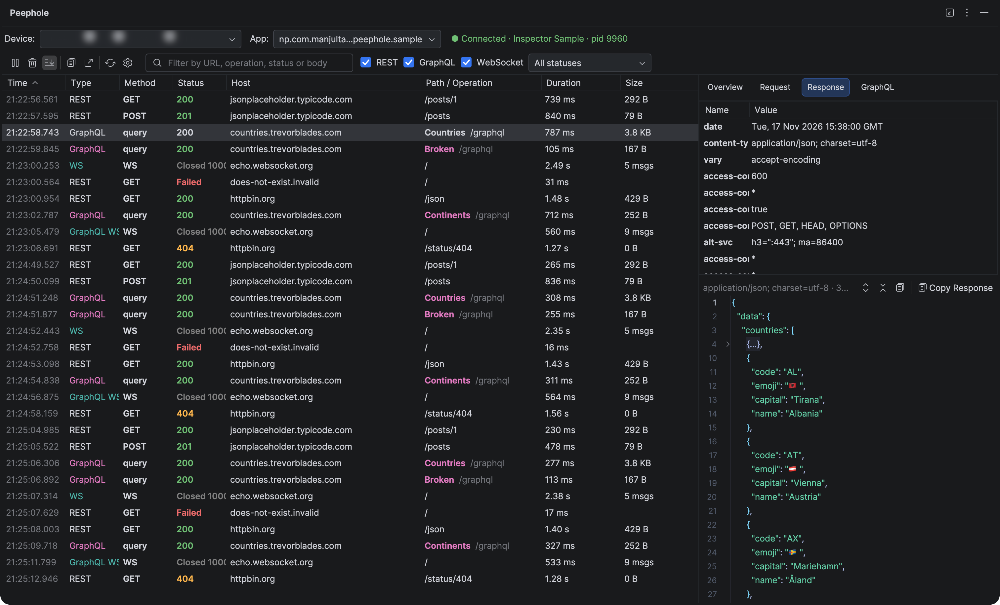
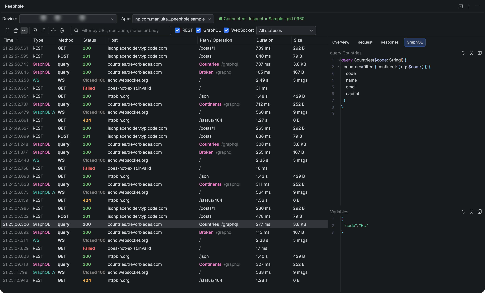
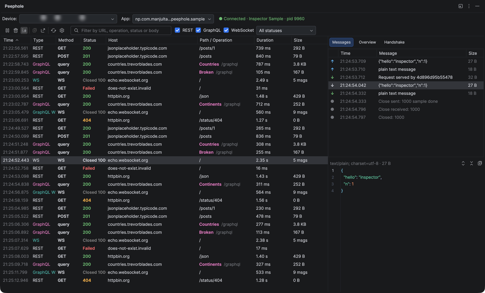
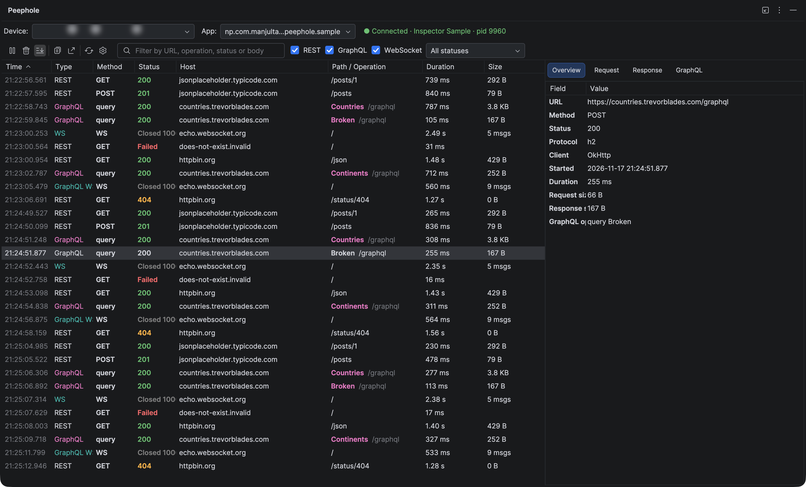
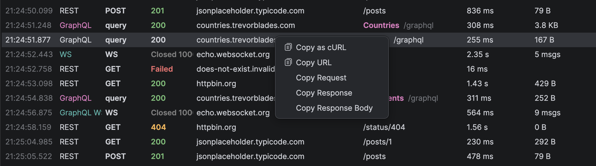

# Peephole

[](https://central.sonatype.com/namespace/np.com.manjultamrakar)
[](https://plugins.jetbrains.com/plugin/36219-peephole)
[](https://plugins.jetbrains.com/plugin/36219-peephole)
[](https://plugins.jetbrains.com/plugin/36219-peephole)
[](#add-the-library-to-your-app)
[](#add-the-library-to-your-app)
[](#add-the-library-to-your-app)
[](LICENSE)

Network inspector for Android Studio: OkHttp and Ktor, REST, GraphQL and WebSocket.

Inspect REST, GraphQL and WebSocket traffic from OkHttp (Retrofit, Apollo) and Ktor apps in a
**Peephole** tool window. Traffic goes over an adb-forwarded socket, never through logcat.



| GraphQL | WebSocket |
|---|---|
|  |  |

| Overview | Copy anything |
|---|---|
|  |  |

## Install the IDE plugin
Install **Peephole** from Settings → Plugins → Marketplace, or build it yourself:
```
./gradlew :plugin:buildPlugin
```
and go to Settings → Plugins → ⚙ → **Install Plugin from Disk…** and pick `plugin/build/distributions/peephole-0.1.0.zip`.
Supports Android Studio 2025.3+. To try it in a sandbox IDE instead, run `./gradlew :plugin:runIde`.

## Add the library to your app
The libraries are on Maven Central:
```kotlin
dependencies {
    debugImplementation("np.com.manjultamrakar:peephole-okhttp:0.1.0")
    releaseImplementation("np.com.manjultamrakar:peephole-okhttp-noop:0.1.0")
    // Ktor:
    debugImplementation("np.com.manjultamrakar:peephole-ktor:0.1.0")
    releaseImplementation("np.com.manjultamrakar:peephole-ktor-noop:0.1.0")
}
```

**OkHttp / Retrofit / Apollo**
```kotlin
val client = OkHttpClient.Builder().addInterceptor(PeepholeInterceptor()).build()
// WebSockets:
PeepholeWebSocketFactory(client).newWebSocket(request, listener)
// Apollo Kotlin:
ApolloClient.Builder().okHttpClient(client)
    .webSocketEngine(DefaultWebSocketEngine(PeepholeWebSocketFactory(client)))
```

**Ktor**
```kotlin
val client = HttpClient(CIO) { install(WebSockets); install(PeepholePlugin) }
client.inspectedWebSocket("wss://…") { send("hi") }   // or: client.webSocketSession(url).inspected()
```

The library starts itself. To change options, call `init` with a config:
```kotlin
Peephole.init(context, PeepholeConfig(
    logToLogcat = false,          // default: logcat stays clean
    maxBodyBytes = 256 * 1024,
    redactHeaders = setOf("Authorization", "Cookie"),
))
```
If you use the Ktor OkHttp engine, add only the Ktor plugin. Adding `PeepholeInterceptor` to that engine as well records every call twice.

## Using the tool window
Choose a **Device** and an **App** at the top. Every connected device and every running process with
the library is listed. Available: filters (REST / GraphQL / WebSocket, status, text), pause, clear,
Copy as cURL, Copy Request / Copy Response (start line, headers and body), and Export HAR.

## Sample
`sample/` exercises every feature. To run all demos automatically:
`adb shell am start -n np.com.manjultamrakar.peephole.sample/.MainActivity --ez autorun true`

## Releasing
1. Bump `peepholeVersion` in `gradle.properties` and add a section on top of `changeNotes` in `plugin/build.gradle.kts`.
2. Libraries: `./gradlew publishToMavenCentral`, then press **Publish** on the deployment at central.sonatype.com
   (or run `publishAndReleaseToMavenCentral` to release in one step). Needs `mavenCentralUsername`,
   `mavenCentralPassword`, `signingInMemoryKey` and `signingInMemoryKeyPassword` in `~/.gradle/gradle.properties`.
3. IDE plugin: `JETBRAINS_MARKETPLACE_TOKEN=… ./gradlew :plugin:publishPlugin`.

## License
MIT. See [LICENSE](LICENSE).
